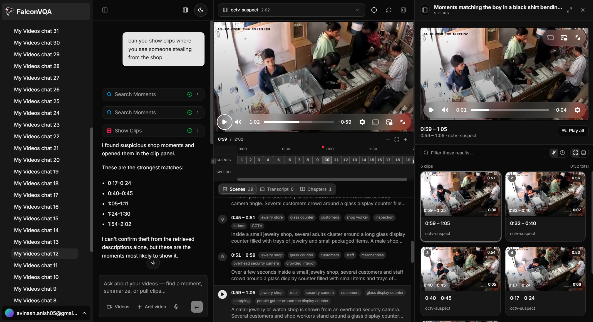

# FalconVQA

**Fast Augmented Language-based CONversational Video Question Answering.**


Ask questions about your videos and get answers grounded in what was actually said and shown,
with timestamps and playable clips.



- **vidra/** — the video RAG library (VIDRA): chunks a video, keeps and describes frames,
  transcribes the audio, embeds it all, searches it, and aggregates to video level
- **backend/** — a FastAPI server on `:8077` that puts VIDRA behind the HTTP API the frontend
  calls (`frontend/lib/core/client.ts`)
- **frontend/** — Next.js app: projects, upload, agent chat (AI SDK), clip artifact panel,
  and the documentation site at `/docs`
- **latex/** — the report

```
Next.js  ──►  /api/agent (AI SDK tools)  ──►  backend (FastAPI)  ──►  vidra  ──►  backend/data/
   │                                              ▲                         (Azure Blob in production)
   ├──► Supabase (auth, projects, conversations, messages, video_core)
   └──► uploads: one-time URL from the backend, file sent straight to its storage
```

Frame descriptions, embeddings, summaries and answers use OpenAI. Whisper, pyannote and the
YOLO/CLIP samplers run locally (CUDA, Apple `mps`, or CPU). Video files and the search index (a
folder per video) live in `backend/data/`, mirrored to Azure Blob Storage when deployed.

---

## 1. Prerequisites

| What | Notes |
|---|---|
| Python 3.11–3.13 | uv installs 3.12 for you |
| [uv](https://docs.astral.sh/uv/) and ffmpeg | `brew install uv ffmpeg` on macOS |
| Node 20+ | For the frontend |
| Supabase project | URL, anon key, and service-role key |
| OpenAI API key | VIDRA's vision, embedding and summary calls |
| HF token | For pyannote's gated speaker model; accept its terms on Hugging Face first |
| A model provider key | OpenAI / Google / Groq / Cerebras / xAI, or LM Studio locally, for the chat |

## 2. backend

```bash
cd backend
uv sync                              # installs vidra (from ../vidra) with all extras
# create backend/.env with OPENAI_API_KEY=... and HF_TOKEN=...

uv run uvicorn app:app --port 8077   # http://127.0.0.1:8077
```

Verify: http://127.0.0.1:8077/health → `status: "ok"` with the analyzers and aggregators.
API docs: http://127.0.0.1:8077/docs.

Optional environment: `VIDRA_TIER` (`free` | `local` | `llm`, default `llm`) caps which
aggregators an ingest runs; `BACKEND_DATA` moves the data folder; `CORE_API_TOKEN` requires
an `X-Core-Token` header matching the frontend's; `AZURE_STORAGE_CONNECTION_STRING` mirrors
the data folder to Azure Blob Storage.

## 3. Database

Run `frontend/lib/supabase/migrations/schema.sql` in the Supabase SQL editor. It creates
`projects`, `conversations`, `messages`, `video_core`, the `project-assets` bucket, and RLS policies.

## 4. frontend

```bash
cd frontend
npm install
cp env.example .env.local
npm run dev
```

Runs on http://localhost:3000. At minimum `.env.local` needs the three Supabase values, one
model provider key, and `CORE_API_URL` — which defaults to `http://127.0.0.1:8077`
Both servers need to be running: the frontend alone cannot ingest or retrieve.

## 5. Deploying

The frontend goes on Vercel; the backend on Azure Container Apps, built and deployed by
`.github/workflows/deploy-backend.yml` from `backend/Dockerfile`, with its data in Azure Blob
Storage. Step by step: `/docs/getting-started/deployment`.

---

## Using it

1. **Create a project** at `/projects` → "New Project". You land on the project workspace.
2. **Upload videos** — Upload using the upload videos button. Drop files in, or paste direct video URLs. Files go
   straight to the backend's storage through a one-time upload URL; URLs it downloads itself. Pick
   the analyzers and the chunking mode in the same dialog — the analyzer list is fetched from
   the backend, not hardcoded.
3. **Wait for analysis.** Each card shows `queued` → `analyzing` (with the current stage) →
   `ready`. The grid polls and reconciles against the backend's job. Analysis is genuinely slow —
   several minutes for a short clip. Only `ready` videos are searchable.
4. **Ask something** in the prompt box (or click a suggestion card). This creates a chat with
   every ready video in scope.
5. **In the chat**, use the **Videos** button next to the model selector to tag exactly which
   videos to search. Tagged videos show as chips above the input.

### What to ask

| You say | The agent calls |
|---|---|
| "What is this about?" / "Why did X happen?" / "Summarise it" | `ask_video` — routed answer + source moments |
| "Find the moment where they discuss X" | `search_moments` — timestamped moments |
| "Show me clips of X" / "Make a highlight reel" | retrieval + `show_clips` → **artifact panel** |
| "What exactly did they say at 2:30?" | `get_video_transcript` |
| "How busy is it? What stands out? Chapters?" | `get_video_insights` — one video-level aggregate |
| "Who was in the video, and for how long?" | `get_video_entities` — people linked across chunks |
| "Tell me everything about that moment" | `read_chunks` — full stored analysis |

Clips open in the right-hand **artifact panel**: a player on top, the clip list below. Click any
row to play that moment; "Play all" plays them back to back. The chat message stays short and
cites `m:ss` timestamps.

---

## Docs

The full documentation site runs with the frontend at **http://localhost:3000/docs** — install,
configuration, the pipeline, analyzers, aggregators, chunking, retrieval, the workspace, and a
complete API reference.

Alongside the code:

- [vidra/README.md](vidra/README.md) — the VIDRA library; open `vidra/docs/index.html` for its
  full documentation
- [backend/app.py](backend/app.py) — the HTTP API, and [backend/engine.py](backend/engine.py)
  for how VIDRA's output maps onto it
